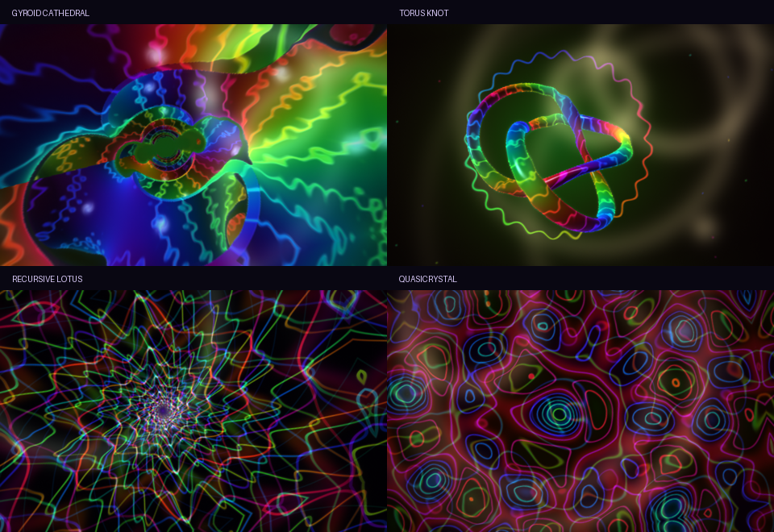

# Hyperspace / Ineffable



Run `./hyperspace` for an evolving audio-reactive journey. `./hyperspace --demo`
uses the built-in silent analysis track. The new edition starts in the gyroid
cathedral and moves through four worlds, with seven-second transitions.
Music drops can bring the next world forward near the end of its stay.

- **Gyroid cathedral** — fly inside a thickened triply periodic gyroid level set,
  with iridescent surfaces, emissive veins, depth fog, and a central passage.
- **Torus knot** — a rotating (3,2) knot with fine flowing surface engravings,
  rim light, and an orbital halo.
- **Recursive lotus** — logarithmic radial repetition and integer angular
  harmonics build interlocking petals and spirals across seven scales.
- **Quasicrystal** — five plane-wave directions and a second frequency scaled
  by the golden ratio create tenfold interference without a repeating tile.

Press **J** to hold/resume the journey, **N** to visit and hold the next world,
**0** to return to the original trip, and **F** for fullscreen. Press **Tab** for settings, or hover the bottom-right corner and click the
fractal button. The Ineffable panel controls world
length, flow speed, and radiance. The dimension menu can select any world.
All the original fractals, media drops, stages, and effects remain available.
Dropping a picture returns to the original picture-seeded trip.

`--classic` starts the original trip. `--dim 6`, `--dim 7`, `--dim 8`, and
`--dim 9` hold the cathedral, knot, lotus, and quasicrystal respectively.
Use `--scale 0.5` to reduce rendering cost on slower GPUs.

## Original backup

`/home/machine_face/hyperspace-backups/before-ineffable-20261022`

This is a complete copy made before any edits, including the original binary,
source, Git state, and uncommitted work. Run its `hyperspace` executable to use
the exact previous version. To restore the source, copy that directory to a new
location (or move the current edition aside first); do not overlay it, since
that would leave new files behind.

## Build

`make -j4` builds the native SDL3/OpenGL application. `Ineffable.glsl` is a C++
raw string included in the scene shader; it is tracked as a build dependency.
The new geometry is procedural and needs no downloaded assets.

## Render validation

The application builds with `make -j4` without warnings. All four worlds, classic mode, and a
32-second journey frame spanning the first transition were rendered using SDL's
offscreen OpenGL driver and visually inspected. The screenshots are in
`screenshots/ineffable/`. The desktop launcher already uses this rebuilt binary.
Interactive desktop/GPU performance must be assessed on the desktop itself;
the editing environment only exposes software OpenGL.

To reproduce a transition check without a display:

```sh
SDL_VIDEODRIVER=offscreen HYPERSPACE_TEST_STEP=0.1 ./hyperspace \
  --demo --shot /tmp/transition.ppm --at 32 --size 480x300 --scale 0.5
```

`HYPERSPACE_TEST_STEP` only affects offscreen shots, advances animation by the
specified number of seconds per frame, and does not make audio deterministic.
The FPS printed with this test option measures simulated time, not GPU speed.
