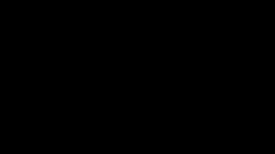
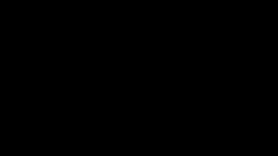

# hyperspace / Ineffable

A DMT-style audio visualizer. It listens to whatever your speakers are playing
and takes you on a trip: from the come-up, through the chrysanthemum, the
breakthrough and into hyperspace, where entities are waiting. The music decides
how deep you go — energy carries you in, drops push you through, and quiet brings
you back.

| | | |
|:-:|:-:|:-:|
|  |  |  |
| Come-up: the grid coming into focus | Chrysanthemum | Breakthrough: a tunnel of pipes |
|  |  |  |
| The fractal dive (mirrored twin) | Pillars | Forest with hills |
|  |  |  |
| Corridor | 3D: Mandelbulb | 3D: Menger sponge |
|  |  |  |
| 3D: Mandelbox | 3D: Sierpinski | 3D: Apollonian |

## The trip

- **Come-up:** breathing colour, an endless grid floor and ceiling in a black
  void sharpening into focus, onset effects from real trip reports (rainbow
  edges breaking into noise, red/green double images, colour seams, static in
  the corners), and **the watchers** — head-and-shoulders figures drifting in at
  the edges of vision, each its own size, tilt, drift and pace.
- **Chrysanthemum:** a kaleidoscope falling inward forever, a Chladni plate
  played by the music, a hyperbolic mosaic at its heart.
- **Breakthrough:** flying down a tube of glossy pipes, square bends and ball
  joints, alien glyphs on the far walls.
- **Hyperspace:** a dome tiled hyperbolically and flowing past, with an entity in
  front — **the Watcher** (rings of eyes), **the Jesters** or **the Mantis** —
  chosen by whether the music is bright or dark.

## Extra dimensions

Press a key to drop into one of these worlds; it morphs in and out, and the
music still drives everything:

- **Fractal dive (6):** a 2D fractal (Mandelbrot, Julia, Burning Ship, Tricorn or
  Multibrot) zooming in forever at a fixed rate while it steers toward the most
  detailed spot. Shown twice — the top half and, below it, the same view
  mirrored and flipped, meeting at a glowing seam like a reflection.
- **3D fractals (5):** raymarched and reactive — a **Mandelbulb** you orbit, a
  **Menger sponge** and **Apollonian** gasket you fly through, a **Mandelbox**,
  a **Sierpinski** tetrahedron and a **quaternion Julia**. One melts into the
  next as a real distance-field morph, not a crossfade. They can also flatten
  into the 2D dive and back, the camera swinging round as the shape thins to a
  sheet.
- **Pillars (7), Forest (8), Corridor (9):** procedural worlds you fly through —
  a hall of monoliths, hills of trees, and a bending tube.

On top of every stage:

- **Patterns:** flower of life, truchet weave, op-art, moiré, a Julia fractal, a
  honeycomb.
- **Mirrors:** left/right, four ways, and kaleidoscopes of 6, 8 and 12.
- **Wireframes:** Metatron's cube, turning 4D polytopes, a ring tunnel.
- **Finish:** neon/chrome edge tracing and glow.

**Film tricks:** about 60 picture effects (datamosh, VHS, thermal, slit-scan,
infinite zoom, zoetrope, point cloud and more) and 24 camera moves (dolly zoom,
whip pan, barrel roll, bolt cam, snorricam and more), several stacked at once.
The music changes them on drops.

**Settings:** press **Tab** for a sidebar with a slider for every effect
(bloom, trail, edge trace, contrast, patterns, wireframes, camera motion, colour
split, sharpness), the dimension and 3D-fractal pickers, the morph speed, and a
**borderless fullscreen** toggle.

## Mathematical worlds (Ineffable)

`--journey` / **J** travels through four woven mathematical worlds — a gyroid
cathedral, a torus knot, a recursive lotus, and a quasicrystal. **N** visits the
next; **0** hands everything back to the music. See
[the Ineffable guide](INEFFABLE.md). `--classic` restores the original startup.

## Start a trip from a picture

Drag a picture, GIF or video onto the window (or `--media file`). The trip starts
over from it:

1. You see the picture as it is.
2. It starts breathing and melting.
3. It gets folded into the kaleidoscope, papered onto the tunnel walls and tiled
   across the dome.

The file is the seed: its colours become the trip's; it decides which effects and
moves you get, so the same file always takes the same trip; things on a plain or
see-through background (a logo, an object on white) are cut out and float in the
trip; GIFs and videos keep playing inside it.

## Run it

    hyperspace            listen to what your speakers are playing
    hyperspace --mic      listen to the microphone instead
    hyperspace --demo     play its own built-in track (silently; it just listens)
    --media file          start the trip from a picture, GIF or video
    --fullscreen          start in borderless fullscreen
    --scale 0.75          how sharp, 0.3-1 (lower is faster)

Keys:

| Key | What it does | Key | What it does |
|---|---|---|---|
| Tab | settings sidebar | 1 2 3 4 | hold the trip at a stage |
| F / F11 | borderless fullscreen | 5 | 3D fractals |
| M | next mirror | 6 | fractal dive |
| P | next pattern | 7 8 9 | pillars / forest / corridor |
| E | next entity | J / N | journey / next world |
| V | next picture effect | 0 | hand everything back to the music |
| C | one camera move at a time | [ ] | less / more sharp |
| | | Esc / Q | quit |

## Build

Linux with PulseAudio or PipeWire. Needs SDL3, libepoxy and libpulse; dropping
pictures in also needs ffmpeg.

    make
    ./hyperspace

`make install` links it into `~/.local/bin`.

Testing: `--demo --stage N --entity N --fx N --cam N --dim N --shot file.ppm --at
seconds --size WxH` saves one frame off-screen and quits (that's how the
screenshots were made).
