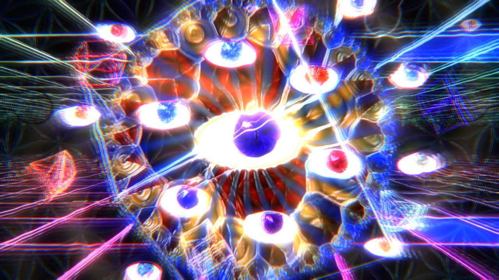
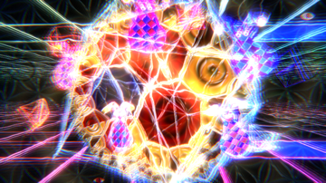
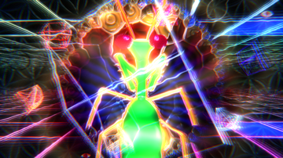
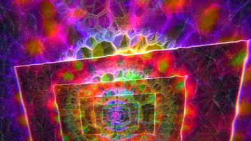
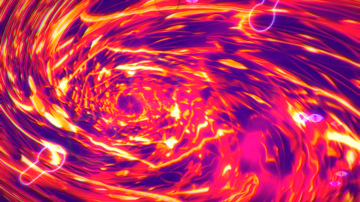
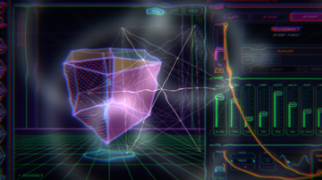

# hyperspace

A DMT-style audio visualizer. It listens to whatever your speakers are playing
and takes you on a trip: from the come-up, through the chrysanthemum, the
breakthrough and into hyperspace, where entities are waiting. The music decides
how deep you go. Energy carries you in, drops push you through, and quiet brings
you back.

| | | |
|:-:|:-:|:-:|
|  |  |  |
| Come-up: the grid coming into focus | Chrysanthemum | Breakthrough: a tunnel of pipes |
|  |  |  |
| The Jesters | The Mantis | Screen in screen, forever |
|  |  |  |
| Thermal camera | A dropped picture, before the trip takes it | The Watcher |

## The trip

- **Come-up:** breathing colour, an endless grid floor and ceiling in a black
  void sharpening into focus, and onset effects taken from real trip reports
  (rainbow edges breaking into noise, red/green double images, colour seams,
  static in the corners).
- **Chrysanthemum:** a kaleidoscope falling inward forever, a Chladni plate
  played by the music, and a hyperbolic mosaic at its heart.
- **Breakthrough:** flying down a tube of glossy pipes, square bends and ball
  joints, with alien glyphs on the far walls.
- **Hyperspace:** a dome tiled hyperbolically and flowing past, with an entity in
  front: **the Watcher** (rings of eyes), **the Jesters** or **the Mantis**,
  chosen by whether the music is bright or dark.

On top of every stage:

- **Patterns:** flower of life, truchet weave, op-art, moiré, a Julia fractal,
  a honeycomb.
- **Mirrors:** left/right, four ways, and kaleidoscopes of 6, 8 and 12.
- **Wireframes:** Metatron's cube, turning 4D polytopes and a ring tunnel.
- **Finish:** neon/chrome edge tracing and glow.

**Film tricks:** about 60 picture effects (datamosh, VHS, thermal, slit-scan,
infinite zoom, zoetrope, point cloud and more) and 24 camera moves (dolly zoom,
whip pan, barrel roll, bolt cam, snorricam and more), several stacked at once.
The music changes them on drops.

**From trip reports:**

- Shapes under a cloak that bends the light around them.
- Ripples of light on the kicks.
- Fireworks made of sacred-geometry mandalas and multiplying cubes.
- On big drops, a breakthrough: the picture shatters like glass, burns to
  white light, or tears like a curtain, and figures appear in the chaos.

## Start a trip from a picture

Drag a picture, GIF or video onto the window (or start with
`--media file`). The trip starts over from it:

1. You see the picture as it is.
2. It starts breathing and melting.
3. It gets folded into the kaleidoscope, papered onto the tunnel walls and tiled
   across the dome.

The file is the seed:

- The trip's colours come from it.
- The file decides which effects and moves you get, so the same file always takes
  the same trip.
- Things on a plain or see-through background (a logo, an object on white) are
  cut out and float in the trip.
- GIFs and videos keep playing inside it.

## Run it

    hyperspace            listen to what your speakers are playing
    hyperspace --mic      listen to the microphone instead
    hyperspace --demo     play its own built-in track (silently; it just listens to it)
    --media file          start the trip from a picture, GIF or video
    --fullscreen          start fullscreen
    --scale 0.75          how sharp, 0.3-1 (lower is faster)

Keys:

| Key | What it does |
|---|---|
| F / F11 | fullscreen |
| 1 2 3 4 | hold the trip at a stage |
| M | next mirror |
| P | next pattern |
| E | next entity |
| V | next picture effect |
| C | one camera move at a time |
| 0 | hand everything back to the music |
| [ ] | less / more sharp |
| Esc / Q | quit |

## Build

Linux with PulseAudio or PipeWire. Needs SDL3, libepoxy and libpulse; dropping
pictures in also needs ffmpeg.

    make
    ./hyperspace

`make install` links it into `~/.local/bin`.

Testing: `--demo --stage N --entity N --fx N --cam N --shot file.ppm --at seconds
--size WxH` saves one frame off-screen and quits (that's how the screenshots were
made).
